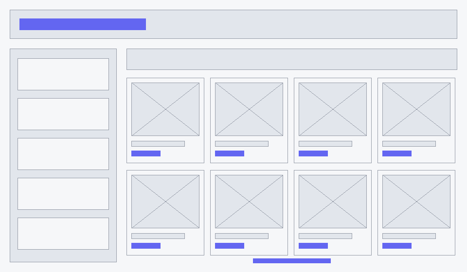
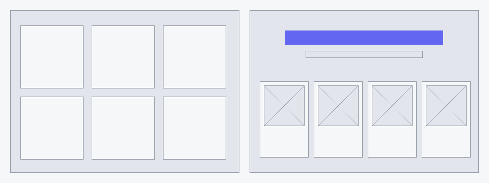

This page covers full stack **3.x**. Still on 2.x? [View the 2.x version of this page](/full-stack/v2/search-results).

<Info>
**Search redirects:** if a query matches a redirect set up in the HIJ dashboard, the widget sends the shopper to the redirect URL before rendering any results. Turn this off with `params.followRedirects: false`.
</Info>

## Initialization

```javascript
HIJ.UIWidgets.SearchResults.init(selector, configurationOptions)
```

`init` accepts two arguments.

<Accordion title="selector: string">

The CSS selector of the element the widget renders into. The element must exist and be visible when `init` runs.

```javascript
HIJ.UIWidgets.SearchResults.init("#hij-search-results", configurationOptions)
```

</Accordion>

<Accordion title="configurationOptions: object">

| Option | Type | Default | Required | Since | Description |
| --- | --- | --- | --- | --- | --- |
| `params` | object | \{\} | Yes | 3.0.0 | Request parameters. `params.query` is required. See the parameter table below. |
| `canAppendQueryStringToUrl` | boolean | `true` | No | 3.0.0 | Whether the widget writes the query, applied filters, sort option and page to `window.location` so the page can be shared and restored. |
| `queryStringPrefix` | string | `"hij_"` | No | 3.0.4 | Prefix for every query string key the widget writes. Change it if another script already uses `hij_` keys. |
| `productsPerRow` | object | `{ desktop: 4, tablet: 3, mobile: 2 }` | No | 3.0.0 | Number of product tiles per row at each breakpoint. |
| `breakpoints` | object | `{ tablet: 768, desktop: 1100 }` | No | 3.0.2 | Pixel widths where the layout switches. |
| `paginationType` | string | `"loadMore"` | No | 3.0.0 | One of `loadMore`, `infiniteScroll` or `links`. Controls which pagination templates render. |
| `scrollToTopOnChange` | boolean | `true` | No | 3.0.9 | Scroll back to the top of the widget after a filter, sort or page change. |
| `templates` | object | \{\} | No | 3.0.0 | Overrides for any template on this page. |
| `callbacks` | object | \{\} | No | 3.0.0 | Hooks for custom logic. See [Callbacks reference](#callbacks-reference). |

</Accordion>

```html
<div id="hij-search-results"></div>
<script>
  onHIJReady(function () {
    HIJ.UIWidgets.SearchResults.init("#hij-search-results", {
      params: {
        query: new URLSearchParams(window.location.search).get("q") || "",
        limit: 24,
      },
      paginationType: "loadMore",
      templates: {},
      callbacks: {},
    });
  });
</script>
```

### Request parameters

| Param | Type | Default | Required | Description | Maps to REST |
| --- | --- | --- | --- | --- | --- |
| `query` | string | | Yes | The shopper's query. | `q` |
| `limit` | number | `24` | No | Products per page. Maximum `96`. Called `perPage` in 2.x. | `per_page` |
| `page` | number | `1` | No | Page to load first. Usually restored from the URL. | `page` |
| `sort` | string | dashboard default | No | Sort option ID, for example `price-asc`. | `sort` |
| `filters` | object | \{\} | No | Pre-applied filters, keyed by filter ID. For example `{ colour: ["blue"] }`. | `f[...]` |
| `followRedirects` | boolean | `true` | No | Follow redirects configured for a query. | `redirects` |
| `fields` | string[] | all | No | Product fields to return. Fewer fields means a smaller response. | `fields` |
| `context` | object | \{\} | No | Extra context passed through to analytics, such as `{ listName: "search" }`. | (not sent) |

## Templates

<Note>
Templates use tagged template literals. Every `render` function receives `html` and an `args` object with `props` (the data for this template) and `templates` (every other template, so you can compose them). Return `null` to render nothing.
</Note>

### Structure

The results page is made of nested templates. The outer `widget` template renders the `header`, the `filters` column and the product list. Each of those is built from smaller templates you can override one by one.



While a request is in flight the `loader` template renders. When a query has no results, the `noResults` template renders instead of the product list, optionally followed by recommendation widgets.



| Template | Parent | Key props | Renders |
| --- | --- | --- | --- |
| `widget` | (root) | `state`, `isLoading`, `hasResults` | The whole page. |
| `loader` | `widget` | `limit` | Skeleton tiles while loading. |
| `noResults` | `widget` | `query`, `suggestedQueries` | The empty state. |
| `noResultsWidgets` | `noResults` | `widgets` | Recommendation strips under the empty state. |
| `header` | `widget` | `query`, `total` | The heading area. |
| `heading` | `header` | `query`, `correctedQuery` | The "Results for ..." text. |
| `productListHeader` | `widget` | `total`, `sortOptions` | The bar above the grid. |
| `infoAndActions` | `productListHeader` | `from`, `to`, `total` | Result count and sort control. |
| `sortOptions` | `infoAndActions` | `sortOptions`, `appliedSortOptionId` | The sort control. |
| `filters` | `widget` | `filters`, `appliedFilters` | The filter column. |
| `filtersHeader` | `filters` | `appliedFiltersCount` | Title and "Clear all". |
| `appliedFilters` | `filters` | `appliedFilters` | Removable chips for applied filters. |
| `filter` | `filters` | `filter` | One filter group. |
| `filterHeader` | `filter` | `filter`, `isOpen` | The group title and toggle. |
| `filterItems` | `filter` | `filter` | Chooses checkbox or range rendering. |
| `filterCheckBoxes` | `filterItems` | `filterId`, `filterItems` | A list of checkbox items, recursively for nested items. |
| `checkboxFilterItem` | `filterCheckBoxes` | `filterId`, `filterItem` | One checkbox. |
| `rangeSliderFilterItem` | `filterItems` | `filter`, `selectedMin`, `selectedMax` | A price or numeric range slider. |
| `products` | `widget` | `products` | The grid. |
| `product` | `products` | `product`, `position` | One product tile. |
| `productListFooter` | `widget` | `pagination` | The area under the grid. |
| `pagination` | `productListFooter` | `currentPage`, `totalPages` | Chooses the pagination style. |
| `loadPrevious` | `pagination` | `hasPreviousPage` | "Load previous" button. |
| `loadNext` | `pagination` | `hasNextPage`, `remaining` | "Load more" button. |
| `paginationLinks` | `pagination` | `pages`, `currentPage` | Numbered page links. |
| `closeIcon` | (shared) | `size` | The icon used on chips and mobile drawers. |

### Reference

<Accordion title="widget">

The root template. Override it only when you need to change the overall layout, for example to move filters above the grid.

```javascript
HIJ.UIWidgets.SearchResults.init(selector, {
  templates: {
    widget: {
      render: function (html, args) {
        var props = args.props;
        var t = args.templates;
        if (props.isLoading && !props.hasResults) {
          return html`<${t.loader} limit=${props.state.params.limit} />`;
        }
        if (!props.hasResults) {
          return html`<${t.noResults} query=${props.state.params.query} />`;
        }
        return html`
          <div class="hij-results">
            <${t.header} query=${props.state.params.query} total=${props.state.total} />
            <div class="hij-results__body">
              <aside class="hij-results__filters">
                <${t.filters} filters=${props.state.filters} appliedFilters=${props.state.appliedFilters} />
              </aside>
              <main class="hij-results__main">
                <${t.productListHeader} total=${props.state.total} sortOptions=${props.state.sortOptions} />
                <${t.products} products=${props.state.products} />
                <${t.productListFooter} pagination=${props.state.pagination} />
              </main>
            </div>
          </div>
        `;
      },
    },
  },
});
```

</Accordion>

<Accordion title="loader">

Renders while the first request is in flight. Later requests (filter, sort and page changes) keep the current products on screen and add the `hij-results--loading` class instead.

```javascript
templates: {
  loader: {
    render: function (html, args) {
      var tiles = Array.from({ length: args.props.limit || 12 });
      return html`
        <div class="hij-loader" aria-busy="true">
          ${tiles.map(() => html`<div class="hij-loader__tile"></div>`)}
        </div>
      `;
    },
  },
}
```

</Accordion>

<Accordion title="noResults">

Renders when a query returns no products. `props.suggestedQueries` holds up to five spelling-corrected or popular queries.

```javascript
templates: {
  noResults: {
    render: function (html, args) {
      var props = args.props;
      return html`
        <div class="hij-no-results">
          <h2>No results for "${props.query}"</h2>
          ${props.suggestedQueries.length > 0 && html`
            <p>Try: ${props.suggestedQueries.map((q) => html`<a href="?q=${encodeURIComponent(q)}">${q}</a> `)}</p>
          `}
          <${args.templates.noResultsWidgets} />
        </div>
      `;
    },
  },
}
```

</Accordion>

<Accordion title="noResultsWidgets">

Show recommendation strips under the empty state so the shopper still sees products. Each entry needs a `recommendationId`, which you find in the HIJ dashboard under **Recommendations**.

```javascript
HIJ.UIWidgets.SearchResults.init(selector, {
  params: { query: "linen shirt" },
  noResultsWidgets: {
    recommendations: [
      { recommendationId: "<RECOMMENDATION-ID>", title: "Popular right now", limit: 8 },
      { recommendationId: "<SECOND-RECOMMENDATION-ID>", title: "New arrivals", limit: 8 },
    ],
  },
});
```

| Key | Type | Required | Description |
| --- | --- | --- | --- |
| `recommendationId` | string | Yes | ID of the recommendation to render. |
| `title` | string | No | Heading shown above the strip. |
| `limit` | number | No | Maximum products. Defaults to `8`. |

<Note>
Recommendation strips send their own `recommendation_viewed` events. You don't need to track them separately.
</Note>

</Accordion>

<Accordion title="header">

Wraps the heading. Return `null` to hide the heading area entirely, for example when your theme already renders one.

```javascript
templates: {
  header: {
    render: function (html, args) {
      return html`<header class="hij-results__header"><${args.templates.heading} ...${args.props} /></header>`;
    },
  },
}
```

</Accordion>

<Accordion title="heading">

`props.correctedQuery` is set when HIJ searched for a corrected spelling instead of the shopper's query.

```javascript
templates: {
  heading: {
    render: function (html, args) {
      var props = args.props;
      if (props.correctedQuery) {
        return html`<h1>Showing results for "${props.correctedQuery}" <small>(you searched for "${props.query}")</small></h1>`;
      }
      return html`<h1>Results for "${props.query}"</h1>`;
    },
  },
}
```

</Accordion>

<Accordion title="productListHeader">

The bar above the product grid. By default it renders `infoAndActions`.

```javascript
templates: {
  productListHeader: {
    render: function (html, args) {
      return html`<div class="hij-list-header"><${args.templates.infoAndActions} ...${args.props} /></div>`;
    },
  },
}
```

</Accordion>

<Accordion title="infoAndActions">

| Prop | Type | Description |
| --- | --- | --- |
| `from` | number | Position of the first product shown. |
| `to` | number | Position of the last product shown. |
| `total` | number | Total matching products. |
| `isMobile` | boolean | `true` below the tablet breakpoint. Use it to show a "Filters" button that opens a drawer. |

```javascript
templates: {
  infoAndActions: {
    render: function (html, args) {
      var p = args.props;
      return html`
        <div class="hij-info-actions">
          <span>${p.from}–${p.to} of ${p.total} products</span>
          ${p.isMobile && html`<button class="hij-open-filters" onClick=${args.helpers.openFilterDrawer}>Filters</button>`}
          <${args.templates.sortOptions} />
        </div>
      `;
    },
  },
}
```

</Accordion>

<Accordion title="sortOptions">

Renders the sort control. Call `args.helpers.applySortOption(id)` when the shopper picks an option.

```javascript
templates: {
  sortOptions: {
    render: function (html, args) {
      var p = args.props;
      return html`
        <label class="hij-sort">
          Sort by
          <select onChange=${(e) => args.helpers.applySortOption(e.target.value)}>
            ${p.sortOptions.map((o) => html`
              <option value=${o.id} selected=${o.id === p.appliedSortOptionId}>${o.label}</option>
            `)}
          </select>
        </label>
      `;
    },
  },
}
```

</Accordion>

<Accordion title="filters">

The filter column. On mobile it renders inside a drawer that `infoAndActions` opens.

```javascript
templates: {
  filters: {
    render: function (html, args) {
      var p = args.props;
      var t = args.templates;
      return html`
        <div class="hij-filters">
          <${t.filtersHeader} appliedFiltersCount=${p.appliedFilters.length} />
          <${t.appliedFilters} appliedFilters=${p.appliedFilters} />
          ${p.filters.map((filter) => html`<${t.filter} key=${filter.id} filter=${filter} />`)}
        </div>
      `;
    },
  },
}
```

<Warning>
Don't filter the `filters` array in this template to hide a filter. Hidden filters still count towards applied filters. Hide filters in the dashboard instead.
</Warning>

</Accordion>

<Accordion title="filtersHeader">

```javascript
templates: {
  filtersHeader: {
    render: function (html, args) {
      return html`
        <div class="hij-filters__header">
          <h2>Filters</h2>
          ${args.props.appliedFiltersCount > 0 && html`
            <button onClick=${args.helpers.clearAllFilters}>Clear all</button>
          `}
        </div>
      `;
    },
  },
}
```

</Accordion>

<Accordion title="appliedFilters">

Each applied filter has `filterId`, `filterItemId`, `label` and, for ranges, `min` and `max`.

```javascript
templates: {
  appliedFilters: {
    render: function (html, args) {
      return html`
        <ul class="hij-applied">
          ${args.props.appliedFilters.map((f) => html`
            <li>
              ${f.label}
              <button aria-label="Remove ${f.label}" onClick=${() => args.helpers.clearFilter(f.filterId, f.filterItemId)}>
                <${args.templates.closeIcon} size="12" />
              </button>
            </li>
          `)}
        </ul>
      `;
    },
  },
}
```

</Accordion>

<Accordion title="filter">

One filter group, such as Colour or Size.

| Prop | Type | Description |
| --- | --- | --- |
| `filter.id` | string | Filter ID, for example `colour`. |
| `filter.label` | string | Display name. |
| `filter.type` | string | `checkbox` or `range`. |
| `filter.items` | array | Items for checkbox filters. Items can have their own `items` for nested values. |
| `filter.min` / `filter.max` | number | Bounds for range filters. |

</Accordion>

<Accordion title="filterHeader">

Toggle a group open or closed with `args.helpers.toggleFilter(filterId)`. Open state is kept per page view.

```javascript
templates: {
  filterHeader: {
    render: function (html, args) {
      var p = args.props;
      return html`
        <button class="hij-filter__header" aria-expanded=${p.isOpen} onClick=${() => args.helpers.toggleFilter(p.filter.id)}>
          ${p.filter.label}
        </button>
      `;
    },
  },
}
```

</Accordion>

<Accordion title="filterItems">

Chooses which template renders the items of a filter. Override it to render a colour filter as swatches, for example.

```javascript
templates: {
  filterItems: {
    render: function (html, args) {
      var f = args.props.filter;
      var t = args.templates;
      if (f.type === "range") {
        return html`<${t.rangeSliderFilterItem} filter=${f} />`;
      }
      return html`<${t.filterCheckBoxes} filterId=${f.id} filterItems=${f.items} />`;
    },
  },
}
```

</Accordion>

<Accordion title="filterCheckBoxes">

Renders a list of checkbox items. It calls itself for nested items, so a selected parent such as "Shirts" shows its children ("Linen shirts", "Oxford shirts") indented underneath.

```javascript
HIJ.UIWidgets.SearchResults.init(selector, {
  templates: {
    filterCheckBoxes: {
      render: function (html, args) {
        var props = args.props;
        return html`
          <ul class="hij-filter-checkboxes">
            ${props.filterItems.map(function (filterItem) {
              return html`
                <${args.templates.checkboxFilterItem}
                  filterId=${props.filterId}
                  filterItem=${filterItem}
                >
                  ${filterItem.selected && filterItem.items
                    ? html`
                        <${args.templates.filterCheckBoxes}
                          filterId=${props.filterId}
                          filterItems=${filterItem.items}
                        />
                      `
                    : null}
                </${args.templates.checkboxFilterItem}>
              `;
            })}
          </ul>
        `;
      },
    },
  },
});
```

</Accordion>

<Accordion title="checkboxFilterItem">

| Prop | Type | Description |
| --- | --- | --- |
| `filterId` | string | ID of the parent filter. |
| `filterItem.id` | string | Item ID, used with `applyFilter` and `clearFilter`. |
| `filterItem.label` | string | Display name. |
| `filterItem.count` | number | Products that match if this item is applied. |
| `filterItem.selected` | boolean | Whether it's applied. |
| `children` | node | Nested items, passed in by `filterCheckBoxes`. |

```javascript
templates: {
  checkboxFilterItem: {
    render: function (html, args) {
      var p = args.props;
      var item = p.filterItem;
      var toggle = function () {
        item.selected ? args.helpers.clearFilter(p.filterId, item.id) : args.helpers.applyFilter(p.filterId, item.id);
      };
      return html`
        <li class="hij-checkbox ${item.selected ? "is-selected" : ""}">
          <label>
            <input type="checkbox" checked=${item.selected} onChange=${toggle} />
            ${item.label} <span class="hij-count">(${item.count})</span>
          </label>
          ${p.children}
        </li>
      `;
    },
  },
}
```

</Accordion>

<Accordion title="rangeSliderFilterItem">

Renders a two-handle slider for price and other numeric filters. Changes are applied when the shopper releases a handle, not on every move.

```javascript
templates: {
  rangeSliderFilterItem: {
    render: function (html, args) {
      var p = args.props;
      return html`
        <div class="hij-range">
          <input type="range" min=${p.filter.min} max=${p.filter.max} value=${p.selectedMin}
            onChange=${(e) => args.helpers.applyFilter(p.filter.id, { min: Number(e.target.value), max: p.selectedMax })} />
          <input type="range" min=${p.filter.min} max=${p.filter.max} value=${p.selectedMax}
            onChange=${(e) => args.helpers.applyFilter(p.filter.id, { min: p.selectedMin, max: Number(e.target.value) })} />
          <output>${args.helpers.formatPrice(p.selectedMin)} – ${args.helpers.formatPrice(p.selectedMax)}</output>
        </div>
      `;
    },
  },
}
```

<Tip>
Price filters are only offered to shoppers in the base market. See `baseMarketCode` in the [quick start](/full-stack/quick-start).
</Tip>

</Accordion>

<Accordion title="products">

```javascript
templates: {
  products: {
    render: function (html, args) {
      return html`
        <ul class="hij-grid">
          ${args.props.products.map((product, i) => html`
            <${args.templates.product} key=${product.id} product=${product} position=${i + 1} />
          `)}
        </ul>
      `;
    },
  },
}
```

</Accordion>

<Accordion title="product">

The product tile. Clicks on the tile are tracked automatically as long as the link has the `data-hij-product-link` attribute.

<Accordion title="Liquid storefronts">

In Liquid themes, product URLs come from the catalog and already include the market prefix.

```javascript
templates: {
  product: {
    render: function (html, args) {
      var product = args.props.product;
      return html`
        <li class="hij-tile">
          <a href=${product.url} data-hij-product-link>
            
            <h3>${product.title}</h3>
            <p class="hij-price">
              ${product.compareAtPrice > product.price && html`<s>${args.helpers.formatPrice(product.compareAtPrice)}</s>`}
              ${args.helpers.formatPrice(product.price)}
            </p>
          </a>
        </li>
      `;
    },
  },
}
```

<Accordion title="Configuring productPageUrl">

If your product pages live under a custom path, build the URL yourself:

```javascript
templates: {
  product: {
    productPageUrl: function (product, context) {
      return "/" + context.marketCode.toLowerCase() + "/p/" + product.handle;
    },
  },
}
```

</Accordion>

</Accordion>

<Accordion title="Headless storefronts">

Headless storefronts usually route with their own router. Prevent the full page load and call your router instead, after the click has been tracked.

```javascript
templates: {
  product: {
    render: function (html, args) {
      var product = args.props.product;
      var onClick = function (e) {
        e.preventDefault();
        args.helpers.trackProductClick(product).finally(function () {
          window.appRouter.push("/products/" + product.handle);
        });
      };
      return html`
        <li class="hij-tile">
          <a href=${"/products/" + product.handle} onClick=${onClick}>
            
            <h3>${product.title}</h3>
            <p>${args.helpers.formatPrice(product.price)}</p>
          </a>
        </li>
      `;
    },
  },
}
```

</Accordion>

</Accordion>

<Accordion title="productListFooter">

```javascript
templates: {
  productListFooter: {
    render: function (html, args) {
      return html`<footer class="hij-list-footer"><${args.templates.pagination} ...${args.props.pagination} /></footer>`;
    },
  },
}
```

</Accordion>

<Accordion title="pagination">

Renders `loadPrevious` and `loadNext` for `loadMore` and `infiniteScroll`, or `paginationLinks` for `links`.

| `paginationType` | Templates rendered | URL updated | Back button restores position |
| --- | --- | --- | --- |
| `loadMore` | `loadPrevious`, `loadNext` | Yes, `hij_page` | Yes |
| `infiniteScroll` | `loadPrevious` (only when starting mid-list) | Yes, `hij_page` | Yes |
| `links` | `paginationLinks` | Yes, `hij_page` | Yes, scrolls to top |

</Accordion>

<Accordion title="loadPrevious">

Shown when the shopper lands on page 2 or later from a shared URL.

```javascript
templates: {
  loadPrevious: {
    render: function (html, args) {
      if (!args.props.hasPreviousPage) return null;
      return html`<button class="hij-load-previous" onClick=${args.helpers.goToPreviousPage}>Load previous</button>`;
    },
  },
}
```

</Accordion>

<Accordion title="loadNext">

```javascript
templates: {
  loadNext: {
    render: function (html, args) {
      if (!args.props.hasNextPage) return null;
      return html`
        <button class="hij-load-next" onClick=${args.helpers.goToNextPage}>
          Load more (${args.props.remaining} left)
        </button>
      `;
    },
  },
}
```

</Accordion>

<Accordion title="paginationLinks">

```javascript
templates: {
  paginationLinks: {
    render: function (html, args) {
      var p = args.props;
      return html`
        <nav class="hij-pages" aria-label="Pages">
          ${p.pages.map((n) => n === "..."
            ? html`<span>…</span>`
            : html`<a href=${args.helpers.getPageUrl(n)} aria-current=${n === p.currentPage ? "page" : null}
                     onClick=${(e) => { e.preventDefault(); args.helpers.goToPage(n); }}>${n}</a>`)}
        </nav>
      `;
    },
  },
}
```

</Accordion>

<Accordion title="closeIcon">

A shared icon used by applied filter chips and the mobile filter drawer.

```javascript
templates: {
  closeIcon: {
    render: function (html, args) {
      var s = args.props.size || 16;
      return html`<svg width=${s} height=${s} viewBox="0 0 16 16" aria-hidden="true"><path d="M3 3l10 10M13 3L3 13" stroke="currentColor" /></svg>`;
    },
  },
}
```

</Accordion>

### Helpers

<Accordion title="UI widget helpers">

Available as `args.helpers` inside every template, and as the second argument of every callback.

| Helper | Description |
| --- | --- |
| `applyFilter(filterId, value)` | Apply a checkbox item ID or a `{ min, max }` range. |
| `clearFilter(filterId, value)` | Remove one applied value. |
| `clearAllFilters()` | Remove every applied filter. |
| `toggleFilter(filterId)` | Open or close a filter group. |
| `applySortOption(sortOptionId)` | Change the sort option. |
| `goToPage(n)`, `goToNextPage()`, `goToPreviousPage()` | Change page. |
| `getPageUrl(n)` | The shareable URL for page `n`. |
| `openFilterDrawer()`, `closeFilterDrawer()` | Control the mobile drawer. |
| `formatPrice(value)` | Format with the configured currency. |
| `trackProductClick(product)` | Send a click event. Returns a promise. |

</Accordion>

<Accordion title="Core helpers">

The widget is built on the headless Connector, so every [Connector helper](/headless/collections#helpers) is also available, such as `getFilters()`, `getAppliedFilters()` and `getSortOptions()`.

</Accordion>

## Callbacks reference

| Callback | Arguments | Return | When it fires | Description |
| --- | --- | --- | --- | --- |
| `beforeAPICall` | `(params, helpers)` | params | Before every request | Change request parameters, for example to add `match_all: true`. |
| `onSuccess` | `(response, helpers)` | none | After a successful response | Read the raw response, for example to update a results count elsewhere on the page. |
| `onFailure` | `(error, helpers)` | none | When the API can't be reached or the response can't be parsed | `error` is `{ type, message }`. The fallback widget takes over after this runs. |
| `beforeRender` | `(state, helpers)` | state | Before each render | Change what's rendered without changing the request, for example to pin a product. |
| `afterRender` | `(state, helpers)` | none | After each render | Run DOM code, such as initialising a quick-view plugin. |
| `onFilterChange` | `(appliedFilters, helpers)` | none | After a filter is applied or cleared | Sync filters with other parts of the page. |
| `onSortChange` | `(sortOptionId, helpers)` | none | After the sort option changes | |
| `onPageChange` | `(page, helpers)` | none | After a page change | |

```javascript
HIJ.UIWidgets.SearchResults.init("#hij-search-results", {
  params: { query: "linen shirt" },
  callbacks: {
    beforeAPICall: function (params) {
      // Require every word to match for short queries.
      if (params.query.split(" ").length <= 2) {
        params.match_all = true;
      }
      return params;
    },
    onSuccess: function (response, helpers) {
      document.querySelector("[data-results-count]").textContent = response.total;
    },
    onFailure: function (error) {
      console.warn("HIJ search unavailable:", error.type, error.message);
    },
    beforeRender: function (state) {
      state.products = state.products.filter(function (p) {
        return !p.tags.includes("hidden-from-search");
      });
      return state;
    },
    afterRender: function () {
      window.dispatchEvent(new CustomEvent("hij:results-rendered"));
    },
  },
});
```

<Warning>
`beforeRender` changes only what's shown. Totals, pagination and analytics still use the original response, so removing many products here can leave short pages.
</Warning>

---

Page reference: `HIJ-FS-CURRENT-K3`
